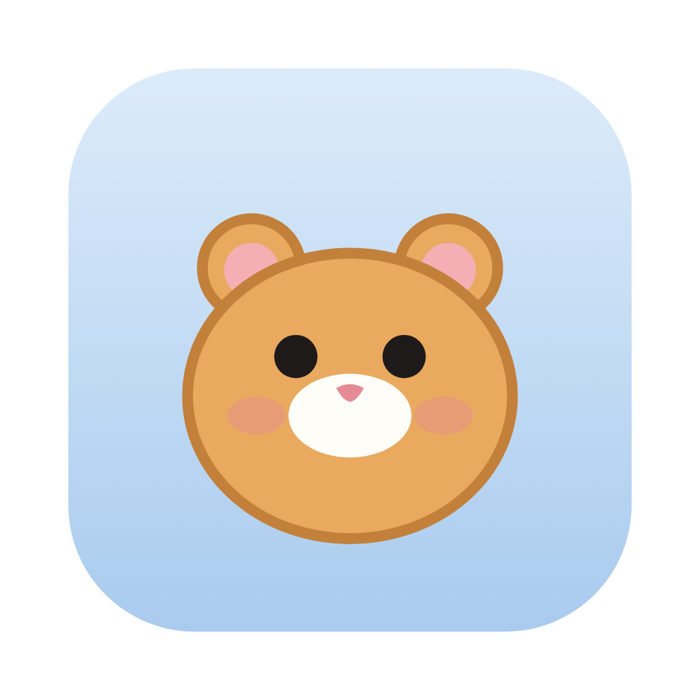

<p align="center">
  
</p>

# Nibblets

[](https://github.com/Infrawrench/nibblets/actions/workflows/ci.yml)

Self-hosted, always-on agents, each one a hamster that chews through tasks for you. They're like Grok Bot or ChatGPT dots, but they run on your own machines and use the Claude and ChatGPT subscriptions you already have.

A nibblet is a thread that never really ends. It runs in its own Docker container on the Claude Agent SDK, Codex, or OpenCode. It wakes on a heartbeat and on schedules it sets for itself, and it remembers things in Postgres with pgvector rather than on its own disk. It can spawn sub-agents, which are child nibblets, and it has a Chromium browser you can watch and take over.

## Running it

On a Linux server or VM, one command sets up Docker or Podman, your agents, and the stack, then links it to Nibblets Connect:

```sh
curl -fsSL https://nibblets.dev/install.sh | bash
```

Run it again to update or to sign in to another agent. Claude Code and Codex can use an Anthropic or OpenAI API key instead of a subscription: pick that when the installer asks, or pass `NIBBLETS_ANTHROPIC_API_KEY` or `NIBBLETS_OPENAI_API_KEY` to it. Each nibblet can then have a monthly budget for what it spends, in its settings.

On a Mac, the desktop app (`apps/desktop`) does all of this for you: it checks Docker, finds your Claude and Codex logins, starts the stack, and opens the UI signed in.

By hand, from the repo:

```sh
docker build -f docker/runner.Dockerfile -t nibblet/runner:dev .
cp docker/.env.example docker/.env   # then fill in the secrets
docker compose -f docker/compose.yaml -p nibblet up -d --build
docker compose -p nibblet exec server node apps/server/src/cli.ts pair
```

Open the link it prints. To reach it from anywhere, press Connect in Settings → Remote access and approve the code on [Nibblets Connect](https://app.nibblets.dev), signed in to your account: every server you connect shows up there.

## How it fits together

See [ARCHITECTURE.md](ARCHITECTURE.md). In short:

- **server**: the API, the UI, the scheduler and heartbeats, the nibblet tools (over MCP), and Docker orchestration
- **db**: Postgres with pgvector, which holds every durable thing
- **credproxy**: holds your Claude and ChatGPT subscription credentials (or API keys, if you'd rather pay per use) and injects them into harness traffic, so containers never see those tokens
- **one runner container per nibblet**: its harness, run as one user, and a guard, run as another, which holds the browser (OpenComputerUse driving Chromium on a headless Wayland display), 1Password and the nibblet's MCP servers behind "ask me first" rules
- **tunnel**: `cloudflared`, run when the server is linked to Nibblets Connect
- **Nibblets Connect** (`apps/connect`): the central service on Cloudflare Workers where you sign in and see every server

To see nibblets from several machines in one place, connect each server to your account and sign in to Nibblets Connect. The desktop app can also skip running a server and just show Nibblets Connect.

## Developing

```sh
corepack enable
pnpm install
pnpm typecheck
pnpm test
pnpm format
```

The server and runner run TypeScript directly on Node 24, with no build step. The web UI is Vite: `pnpm --filter @nibblet/web dev` proxies the API to a server on `:8420`.

### Releasing

`pnpm release 0.2.0` sets every package's version, commits and pushes. The Release workflow then publishes the server, runner and credential proxy images to GHCR for both architectures, builds the Mac app on Apple Silicon and Intel, signs and notarises it, and makes the `v0.2.0` GitHub release. [nibblets.dev](https://nibblets.dev) serves its downloads, and servers and the app offer it as an update.

Harnesses are plugins (`packages/harness-*`) that implement `HarnessPlugin` from `@nibblet/harness`. Credential sources in the proxy and embedding backends in the server follow the same pattern.

## Licence

GPL-2.0. See [LICENSE](LICENSE).
